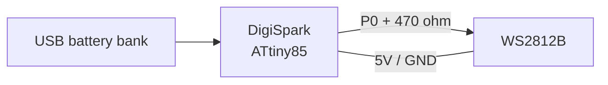

# DigiSpark Red Light / Green Light Game

A handheld red light / green light indicator for the playground game, built on
a DigiSpark (ATtiny85) and a single WS2812B LED. Power it from a USB battery
bank, hold it up, and shout.

I built the original in 2017 for my kids. The hardware still works, so this is
a firmware and documentation refresh rather than a redesign.

[](https://github.com/rj45jack/DigiSpark-Red-Light-Green-Light-Game/actions/workflows/firmware.yml)
[](LICENSE)

## How it plays

| Phase | LED | Duration |
|---|---|---|
| Gap | off | 0.5 s |
| Go | green | 3–10 s |
| Stop | red | 3–10 s |

Each gap ends in a colour, except that one time in three it repeats for
another 0.5 s first. That keeps the next colour from being perfectly
predictable.

Each power-up produces a different sequence. The original firmware called
`randomSeed(27)`, so it replayed the same pattern every time the battery was
plugged in; this version seeds from `micros()` mixed with noise from an
unconnected ADC pin.

## Parts

- DigiSpark (generic ATtiny85 board, 16.5 MHz)
- One WS2812B / NeoPixel
- 470 Ω resistor (recommended)
- 1000 µF electrolytic capacitor (recommended)
- USB battery bank and a short USB cable

## Wiring

| WS2812B | DigiSpark |
|---|---|
| VCC / VDD | 5V |
| GND / VSS | GND |
| DIN / DI | P0 through a 470 Ω resistor |
| DOUT / DO | not connected |

```
DigiSpark                 WS2812B
   5V  ------------------ VCC
  GND  ------------------ GND
   P0  ---[ 470 ohm ]---- DIN
                           DOUT  (unused)
```

Add the 1000 µF capacitor across VCC and GND at the LED, and keep the data
wire short. Both are standard WS2812B precautions against the first pixel
latching noise.



Do not use P3 or P4 for the LED: they are the USB data lines, and the board
will not enumerate if something is connected to them.

## Build and flash

### PlatformIO

```bash
cd firmware
pio run                 # build
pio test -e native      # host-side schedule tests
pio run -t upload       # flash over the micronucleus bootloader
```

The upload uses the DigiSpark's micronucleus bootloader, which only waits a
few seconds after power-up. `pio` will prompt you to plug the board in.

### Arduino IDE

1. Install the Digistump AVR board support (the DigiSpark board package).
2. Select **Digispark (Default - 16.5 MHz)**.
3. Install **Adafruit NeoPixel** from the Library Manager if it is not already
   present.
4. Open `firmware/traffic/traffic.ino` and upload.

The Digistump core is old and its package index is sometimes unavailable. If
the Board Manager cannot fetch it, use PlatformIO; it pulls the same core from
the PlatformIO registry.

## Tuning the game

Timing lives in `firmware/traffic/game.h`:

| Constant | Default | Meaning |
|---|---|---|
| `traffic::kDarkMs` | 500 | gap between coloured phases |
| `traffic::kColorMinMs` | 3000 | shortest green or red phase |
| `traffic::kColorMaxMs` | 10000 | upper bound for a coloured phase |

`kColorMaxMs` is exclusive, matching `random(min, max)` in the original.

Brightness lives in `firmware/traffic/traffic.ino`:

```cpp
constexpr uint8_t BRIGHTNESS = 64;  // 0-255
```

Full brightness on a bare WS2812B is uncomfortably bright and draws about
60 mA. `64` is roughly 25% duty cycle and still clearly visible.

## How it is put together

`game.h` contains the schedule as a small state machine with its own xorshift
random generator. It has no Arduino dependency, so the tests on a normal
computer can cover the parts that are easy to get wrong: durations, the
colour/gap alternation, seed reproducibility, and `millis()` wraparound.

`traffic.ino` is the hardware layer: it seeds the generator, maps phases to
LED colours, and advances the game only when the current phase is due. The
loop never blocks, so a button, buzzer, or second LED can be added later
without restructuring the timing.

## Troubleshooting

| Symptom | Likely cause |
|---|---|
| LED never lights | WS2812B needs 5 V, not 3.3 V; check VCC, GND, and that data goes to DIN rather than DOUT. |
| First pixel flashes random colours at power-up | Normal for WS2812B; the firmware clears it during `setup()`. |
| Green shows as red (or vice versa) | The LED is RGB rather than GRB; change `NEO_GRB` to `NEO_RGB` in `traffic.ino`. |
| Flicker or wrong colours when the board moves | Long or loose data wire; add the 470 Ω resistor, shorten the wire, and fit the capacitor. |
| Upload fails | The bootloader window is only a few seconds; replug when prompted and use a USB cable that carries data. |
| Same pattern every power-up | Old firmware; this version seeds from noise. |
| Too bright or too dim | Change `BRIGHTNESS`. |

## Repository layout

```
firmware/
  platformio.ini
  traffic/
    traffic.ino   hardware setup and LED output
    game.h        schedule state machine, host-testable
  test/
    test_game/    host tests for the schedule
.github/workflows/firmware.yml
```

## Verification

- `pio test -e native` — 9/9 tests pass: phase durations, colour/gap
  alternation, gap rerolls, seed reproducibility, seed divergence, and
  `millis()` wraparound.
- `pio run -e digispark-tiny` — 2,924 bytes flash (48.6% of 6,012) and
  53 bytes RAM (10.4% of 512).

This is compile-tested and unit-tested, not hardware-tested; the original
board was not available to re-flash.

## License

Apache-2.0. See [`LICENSE`](LICENSE).
